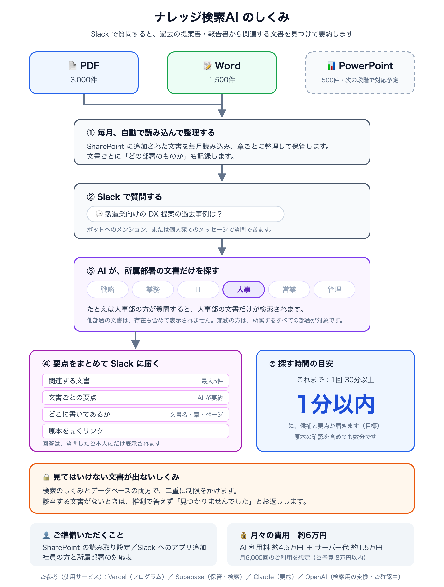

# 大規模ナレッジ検索AI（Slack連携・部署別アクセス制御）— コンサルティング会社想定（模擬案件）

コンサルティング会社（従業員100名）のナレッジ担当からの依頼「過去10年分の提案書や報告書が5,000件以上あり、必要な情報を探すのに毎回30分以上かかる。Slackで聞いたら関連する文書を見つけて要約してくれるAIが欲しい。アクセス権限の管理が必須」を起点とした模擬案件です。AIエンジニア講座の一環として、ヒアリング〜提案〜実装〜本番デプロイ〜納品物の作成までを行いました。

**本番URL**: https://knowledge-search-slack.vercel.app （Slackの受け口と定期実行のみ。画面はありません）



## この案件でやったこと

- 依頼文の曖昧な3語（「5,000件」「アクセス権限」「見つけて要約」）をヒアリングで具体化した。権限は「防ぎたい事故」「いまの管理方法」「全社員が見てよい割合」に分けて聞いた（[`ヒアリングシート.md`](./ヒアリングシート.md)）
- 「Claude API利用可」という情シスの許諾が、**Embeddingの送信先を含まない**ことに設計前に気づき、提案書の確認事項にした（[`提案書.md`](./提案書.md)）
- **セクション単位チャンキング**：見出しで区切って1セクションを1チャンクにし、検索用の文字列の先頭に文書名・部署・客先・年・章の名前を付ける
- **部署別アクセス制御**：検索関数とRLSの二重。Slackの発言者をデータベースのユーザーに引き当て、**本人として検索する**ので、サーバー側のボットでもRLSが効く
- 絞り込みつきの検索で**件数が足りなくなる問題**を実測で見つけた（20件要求して4件）。pgvectorの反復スキャンで解消
- **出典はAIに書かせない**：Claudeには根拠にした文書と箇所の番号だけを返させ、表示する出典はデータベースの値から組み立てる
- **Slackの3秒ルール**：受付（署名の検証・重複の確認）だけ同期で行い、検索と要約は `after()` で非同期に実行する。「考え中…」を出し、同じメッセージを進捗 → 回答に書き換える。チャンネルでのメンションには回答を出さず、DMに送る
- **監査ログ**：検索と記録を1つのデータベース関数にまとめ、記録できなければ回答も返らないようにした
- **機密文書のガバナンス**：機密扱いへの変更、完全削除（監査ログからの参照の削除、再取り込みの防止）を1回の操作で行う（[`docs/ガバナンス手順書.md`](./docs/ガバナンス手順書.md)）
- PDFから取り出した漢字が見た目の同じ別の文字になる問題、Slackで太字の記号が効かない問題、本番でだけPDFの部品が読み込めない問題を、実機とログで見つけて直した

## 検証結果

| 項目 | 結果 |
|---|---|
| Recall@5（テスト質問） | 9問中9問 |
| 質問から回答まで（12問） | 12問合格。該当なしの2問は「見つかりませんでした」 |
| 部署別の閲覧制限（本番） | 9ユーザー×3項目すべて合格 |
| 実際のSlackでの応答 | 4.2〜8.1秒 |

本番の文書は、共有されたサンプル4本と検証用のダミー2本の計6本です。**5,000件の規模では検証していません**（[`納品チェックリスト.md`](./納品チェックリスト.md)）。

## 技術スタック

Next.js 16（App Router, Route Handlers, `after()`）／Vercel（Cron）／Supabase（Postgres, pgvector, RLS, Auth, Storage、東京リージョン）／Claude API（`claude-opus-5-5`、構造化出力）／OpenAI Embeddings（`text-embedding-3-large`、1536次元）／Slack Events API・Web API

## ドキュメント

| ドキュメント | 内容 |
|---|---|
| [提案書.md](./提案書.md)（[PDF](./提案書.pdf)） | A4・1枚の提案書 |
| [ヒアリングシート.md](./ヒアリングシート.md)（[PDF](./ヒアリングシート.pdf)）／[ヒアリング回答.md](./ヒアリング回答.md) | ヒアリング項目16問と回答 |
| [スコープ.md](./スコープ.md) | MVP / Phase 2 の切り分け、設計の決定、合格基準、実装で分かったこと |
| [docs/architecture.png](./docs/architecture.png) | 構成図（技術版） |
| [引き継ぎ資料.md](./引き継ぎ資料.md)（[PDF](./引き継ぎ資料.pdf)） | クライアント向け、A4・1枚 |
| [docs/ガバナンス手順書.md](./docs/ガバナンス手順書.md) | 機密扱いへの変更・完全削除・監査ログの確認・所属の変更 |
| [docs/開発者向け引き継ぎ.md](./docs/開発者向け引き継ぎ.md) | 構成、設計上の約束ごと、コマンド、未実装の点 |
| [納品チェックリスト.md](./納品チェックリスト.md) | 8項目の結果と根拠、規模の検証状況 |
| [振り返り.md](./振り返り.md) | 案件3（小規模RAG）との比較、うまくいったこと・いかなかったこと |

## システム構成

```
Slack ─イベント─→ /api/slack/events ─ 署名検証 → 重複確認 → すぐ200（同期）
                                        └ after() ─ 本人として検索（RLS）＋監査ログ → Claudeで要約 → DMに回答

取り込み元 ─Cron（毎日）─→ /api/cron/ingest ─ 抽出 → セクション分割 → Embedding → pgvector
監査ログ ──Cron（毎月）─→ /api/cron/audit-report ─ 部署別の利用状況をSlackに通知
```

## セットアップ

1. `npm install`
2. `.env.example` を `.env.local` にコピーし、各サービスの値を設定する
3. Supabase の SQL Editor で `supabase/schema.sql`、続けて `supabase/migrations/` のSQLを番号順に実行する
4. `npm run check:connections` で接続を確認する
5. `npm run seed:users` → `npm run check:rls` で、部署別の閲覧制限が効くことを確認する
6. `npm run ingest` でサンプル文書を取り込み、`npm run check:answers` で12問を検証する
7. Slackアプリを `slack/manifest.yml` から作成し、`npm run register:user` で利用者の所属を登録する

コマンドの一覧は [docs/開発者向け引き継ぎ.md](./docs/開発者向け引き継ぎ.md) にあります。
